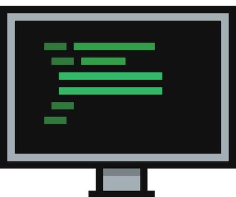
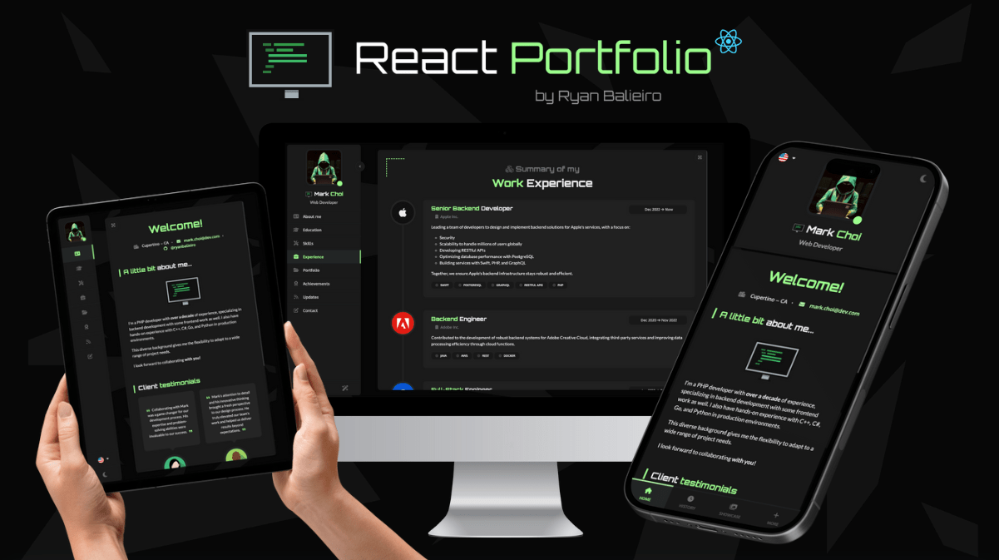

<p align="center">
    
</p>

<h1 align="center">Design Heaven</h1>

<p align="center">
    <strong>Creative Design & Digital Development Studio</strong><br>
    <em>Crafting bespoke digital experiences, intuitive interfaces, and cutting-edge web applications.</em>
</p>

<p align="center">
    <a href="#-features">Features</a> •
    <a href="#-tech-stack">Tech Stack</a> •
    <a href="#-getting-started">Getting Started</a> •
    <a href="#-project-structure">Project Structure</a> •
    <a href="#-customization">Customization</a> •
    <a href="#-contact">Contact</a>
</p>

---

## 🌟 Overview

**Design Heaven** is a creative design and digital development studio portfolio built with **React** and **Bootstrap 5**, powered by **Vite**. Engineered with a futuristic, cyber-aesthetic design language, the website delivers a dynamic, high-performance experience with seamless page flipping transitions, responsive mobile tabs, multi-language localization, and instant dark/light theme switching.



---

## ✨ Key Features

- 🎨 **Futuristic Design System**: Sleek glassmorphism, glowing accents, cybernetic UI components, and tailored dark/light color themes.
- 📱 **Fully Responsive Layout**:
  - **Desktop**: Split-view fixed central layout with collapsible sidebar and smooth page-flipping transitions.
  - **Mobile**: Converts into a modular tabbed interface with bottom navigation bar.
- 🌐 **Multi-Language Support (i18n)**: Out-of-the-box support for English, Spanish, French, and Korean with instant locale switching.
- 🌓 **Dynamic Theme Switcher**: Effortlessly switch between Dark Mode and Light Mode with saved user preferences.
- ✉️ **Zero-Backend Contact Form**: Integrated with **EmailJS** for direct client inquiries without requiring a dedicated backend server.
- 📄 **100% Data-Driven Architecture**: All portfolio items, skills, experiences, testimonials, and branding are structured in modular JSON configuration files.
- 🚀 **Blazing Fast**: Bundled and optimized with **Vite** for instantaneous development refresh and lightweight production builds.
- 🎧 **Interactive Micro-Experiences**: Interactive audio pronunciation, dynamic text typing animations, custom cursor effects, and smooth scroll mechanics.

---

## 🛠 Tech Stack

| Layer | Technology |
|---|---|
| **Framework** | [React 18](https://react.dev/) |
| **Bundler & Tooling** | [Vite 6](https://vitejs.dev/) |
| **Styling & UI** | [Bootstrap 5](https://getbootstrap.com/), [Sass (SCSS)](https://sass-lang.com/) |
| **Icons** | [Font Awesome 6](https://fontawesome.com/), [PrimeIcons](https://primefaces.org/) |
| **Sliders & Carousels** | [Swiper 14](https://swiperjs.com/) |
| **Smooth Scrolling** | [Smooth Scrollbar](https://github.com/idiotWu/smooth-scrollbar) |
| **Email Handling** | [EmailJS](https://www.emailjs.com/) |

---

## 📂 Project Structure

```text
Design-Heaven/
├── docs/                      # Documentation assets and customization tutorials
├── npm/                       # Helper scripts for creating new sections and maintenance
├── public/
│   ├── audio/                 # Audio files and sound effects
│   ├── data/                  # Core data layer (JSON configuration files)
│   │   ├── sections/          # Section data (cover, contact, skills, portfolio, etc.)
│   │   ├── categories.json    # Mobile category mappings
│   │   ├── profile.json       # Studio branding, identity, and localized roles
│   │   ├── sections.json      # Registered section order and layout settings
│   │   ├── settings.json      # Preloader, themes, and application configurations
│   │   └── strings.json       # UI strings and localized labels
│   └── images/                # Studio imagery, project previews, icons, and flags
├── src/
│   ├── components/            # Reusable UI components, widgets, and layout modules
│   ├── hooks/                 # Custom React hooks, utilities, and models
│   ├── providers/             # React Context Providers (Theme, Language, Navigation)
│   ├── styles/                # Global SCSS stylesheets, variables, and theme definitions
│   └── main.jsx               # Application entry point
├── index.html                 # HTML template with SEO and Open Graph metadata
├── package.json               # Project dependencies and npm scripts
└── vite.config.js             # Vite build configuration
```

---

## 🚀 Getting Started

### Prerequisites

Ensure you have **Node.js** (v18 or higher recommended) and **npm** installed on your machine.

### Installation

1. **Clone the repository:**
   ```bash
   git clone https://github.com/designheaven/design-heaven.git
   cd Design-Heaven
   ```

2. **Install project dependencies:**
   ```bash
   npm install
   ```

3. **Start the local development server:**
   ```bash
   npm run dev
   ```
   Open [http://localhost:5173](http://localhost:5173) in your browser to view the application.

4. **Build for production:**
   ```bash
   npm run build
   ```
   The compiled production-ready assets will be generated in the `dist/` directory.

5. **Preview production build locally:**
   ```bash
   npm run preview
   ```

---

## ⚙️ Customization & Configuration

All studio content is completely decoupled from the presentation components and lives inside `public/data/`:

- **Identity & Branding**: Edit [`public/data/profile.json`](file:///public/data/profile.json) to configure studio name, avatar, bio roles, and pronunciation.
- **Contact Channels**: Edit [`public/data/sections/contact.json`](file:///public/data/sections/contact.json) to update phone, email, and social media handles.
- **Hero & Overview**: Edit [`public/data/sections/cover.json`](file:///public/data/sections/cover.json) to customize studio introduction, inline badges, and client testimonials.
- **Projects & Portfolio**: Edit [`public/data/sections/portfolio.json`](file:///public/data/sections/portfolio.json) to add or modify client case studies.
- **Global Settings & Preloader**: Edit [`public/data/settings.json`](file:///public/data/settings.json) to configure the preloader logo, default language, and default theme.

---

## 📬 Contact Design Heaven

Have a project in mind or want to collaborate? Connect with the Design Heaven studio:

- 📍 **Location**: San Francisco, CA
- 📞 **Phone**: [+1 (555) 789-2468](tel:+15557892468)
- ✉️ **Email**: [hello@designheaven.com](mailto:hello@designheaven.com)
- 💼 **LinkedIn**: [@designheaven](https://linkedin.com/company/designheaven)
- 📸 **Instagram**: [@designheaven](https://instagram.com/designheaven)
- 🌐 **Facebook**: [Design Heaven](https://facebook.com/designheaven)
- 🐙 **GitHub**: [@designheaven](https://github.com/designheaven)

---

## 📄 License

This project is licensed under the [MIT License](LICENSE).